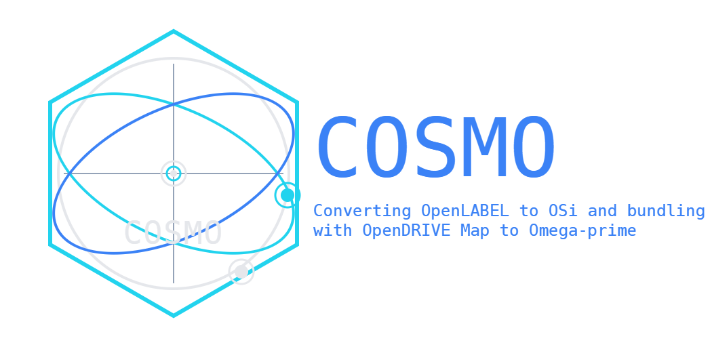
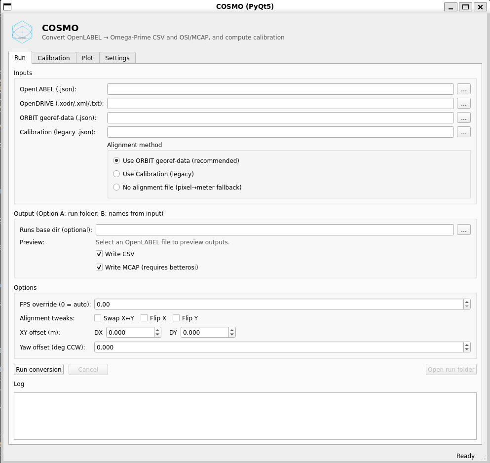

<p align="center">
  <picture>
    <source srcset="docs/images/cosmo_logo_with_text.drawio.svg" type="image/svg+xml">
    
  </picture>
</p>

# COSMO - OpenLABEL + OpenDRIVE → Omega‑Prime

[](https://github.com/RI-SE/COSMO/actions/workflows/ci.yml)
[](https://www.gnu.org/licenses/gpl-3.0)

[](https://www.asam.net/standards/detail/opendrive/)
[](https://www.asam.net/standards/detail/openlabel/)
[](https://github.com/ika-rwth-aachen/omega-prime)

COSMO converts **ASAM OpenLABEL** annotations into:

- **Omega‑Prime compatible CSV** (moving-object table)
- optionally **MCAP** containing **ASAM OSI GroundTruth**, optionally bundled with an **OpenDRIVE** map.



> [!NOTE]
> This is a beta version. Bugs and missing features should be expected. Github issues can be added for bug reports or feature requests.

> Maintained by **RISE Research Institutes of Sweden**. Developed in the SYNERGIES project.

---

## How COSMO fits in

```text
 SAVANT markit ──► OpenLABEL (objects, rbboxes per frame, weather tags) ─┐
 ORBIT ─────────► georef (pixel→ground) + OpenDRIVE map ─────────────────┤
 DJI drone ─────► SRT (per-frame time, GPS, exposure), flight record ────┼─► cosmo convert ─► CSV + MCAP (OSI GroundTruth)
 upstream tools ► DPR provenance files ──────────────────────────────────┘                    + provenance record
```

Only the OpenLABEL file is required. Each extra input adds data:
- **georef** (or a `cosmo calibrate` calibration): world positions, headings and sizes.
- **OpenDRIVE**: the map embedded in the MCAP.
- **SRT** / flight record: exact frame timing, time of day, sun position, illumination.
- **DPR files**: provenance of the inputs, carried into the output's provenance record.

The mapping from OpenLABEL classes and tags to OSI is listed in [OSI/MCAP output and mapping](docs/reference/osi-mapping.md).

## Install

With [uv](https://docs.astral.sh/uv/) (the project ships a `uv.lock`):
```bash
uv sync --group cosmo-cli            # CLI with MCAP output and plots
uv sync --group cosmo-gui            # + GUI
uv sync --group trajectory-explorer  # trajectory viewer
uv sync --all-groups                 # everything, incl. dev tools
```

With pip (≥ 25.1): `python -m pip install -e . --group cosmo-gui`. Dependency groups are not pip extras,
so `pip install -e ".[gui]"` does not work.

## Usage

### GUI
```bash
cosmo gui
```
Pick the OpenLABEL file, the georef (or calibration) file and optionally the OpenDRIVE map and DJI SRT in
the **Run** tab, then **Run conversion**. Other tabs compute a calibration and plot results.

### CLI
```bash
cosmo convert scenario.json --georef-data site_georef_data.json --odr site.xodr -o runs/
```
This writes `runs/<timestamp>_convert_<name>/` with `outputs/<name>.csv`, `outputs/<name>.mcap`,
`run_inputs.json` and `run_summary.json`. Plain `cosmo` without a subcommand starts the GUI; use
subcommands on headless machines.

With all optional inputs, as in the drone pipeline:
```bash
cosmo convert An_VIDa_<ts>_D.json \
  --georef-data VIDr_ff_<ts>_georef.json \
  --odr map.xodr \
  --srt VIDc_<ts>_D.srt \
  --flight-record FlightRecord_<ts>.video_stats.json \
  --srt-prov DPR_VIDc_<ts>_D.json \
  --output-prefix out/OmegaPrime_<name> \
  --prov-out out/DPR_OmegaPrime_<name>.json
```
- `--srt`: frame timing from the drone clock (29.97 fps instead of an assumed 30) and OSI environmental conditions.
- `--frame-offset N|auto`: annotated frame k is SRT frame k+N. The default `auto` reads it from the `--prov-in` chain:
  FieldDataLab `vidrectify` output made before 2026-10-21 dropped the first frame (N=1); newer output is aligned (N=0).
- `--flight-record`: start time/position without SRT; needed for `--bbox-correction`.
- `--output-prefix`: write `<prefix>.csv/.mcap` directly instead of a run folder.
- `--prov-out` with `--srt-prov` (and `--georef-prov`, `--opendrive-prov`, `--flight-record-prov`): provenance record.
- Uncertainty: `<prefix>.companion.json` (OpenLABEL with run- and object-level quality) is written by default;
  `--companion-frames` adds per-frame covariance, `--video-quality` uses FieldDataLab's stabilisation sidecar,
  `--smooth-kinematics` smooths v and a, `--sensor-data` adds an OSI SensorData topic. See
  [outputs](docs/reference/outputs-omega-prime.md#uncertainty-companion-openlabel-and-sensordata).

### Other tools
- `cosmo correct`: corrects bboxes from an oblique (tilted) drone camera and writes a corrected OpenLABEL.
  `cosmo convert --bbox-correction` does the same inline.
- `cosmo calibrate`: computes a pixel→ground calibration from matched points when no ORBIT georef exists
  ([how-to](docs/how-to/calibration.md)).
- `trajectory-explorer`: compares up to three CSV/MCAP/OpenLABEL sources on an OpenDRIVE map.

## Documentation

- [Workflow guide](docs/user_guide/workflow.md): inputs, GUI and CLI conversion, checking results
- [CLI reference](docs/user_guide/cli.md): all commands and options
- Reference: inputs ([OpenLABEL](docs/reference/inputs-openlabel.md), [georef/calibration](docs/reference/inputs-georef.md),
  [OpenDRIVE](docs/reference/inputs-opendrive.md), [DJI SRT](docs/reference/inputs-srt.md),
  [flight record](docs/reference/inputs-flight-record.md)); outputs ([CSV and run files](docs/reference/outputs-omega-prime.md),
  [OSI/MCAP and mapping tables](docs/reference/osi-mapping.md))
- How-to: [calibration](docs/how-to/calibration.md), [troubleshooting](docs/how-to/troubleshooting.md)
- Developer: [georef pipeline](docs/developer_guide/georef-pipeline.md), [tests](docs/developer_guide/tests.md),
  [contributing](CONTRIBUTING.md), [changelog](CHANGELOG.md)

---

## Status and License

- Beta.
- COSMO is licensed under the [GNU General Public License v3.0 (GPL-3.0)](LICENSE).

## Acknowledgement
<br><div align="center">
  
</div>

This package is developed as part of the [SYNERGIES](https://synergies-ccam.eu/) project.

<br><div align="center">
  
</div>

Funded by the European Union. Views and opinions expressed are however those of the author(s) only and do not necessarily reflect those of the European Union or European Climate, Infrastructure and Environment Executive Agency (CINEA). Neither the European Union nor the granting authority can be held responsible for them.
